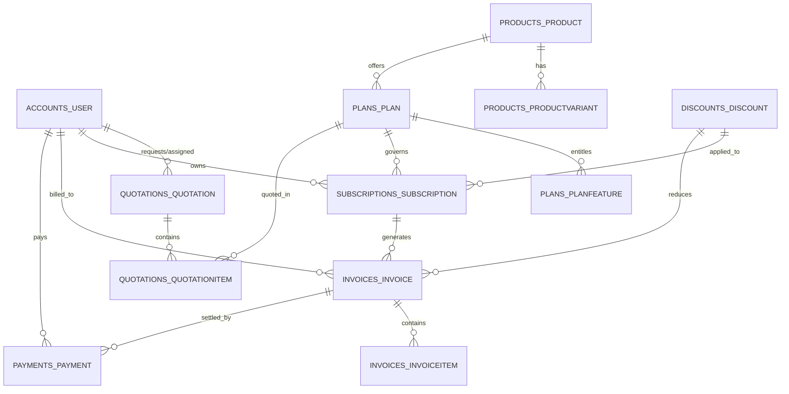

# Brightloop – Subscription Management System
## Centralized PostgreSQL Database Schema

### 1. Schema Architecture Overview

The Brightloop database is modeled around a core B2B subscription lifecycle:
1. **Accounts**: System users with granular role-based permissions (`ADMIN`, `STAFF`, `CUSTOMER`).
2. **Products & Plans**: Software products with configurable variants and subscription tiers (billing intervals, trial periods).
3. **Quotations**: Pre-subscription sales quotes with line items that convert into active subscriptions.
4. **Subscriptions**: The central lifecycle engine (`TRIALING`, `ACTIVE`, `PAST_DUE`, `CANCELED`, `PAUSED`).
5. **Invoices & Payments**: Billing records, recurring invoices, line items, and payment gateway transactions.
6. **Discounts**: Promotional coupon codes and percentage/fixed discounts.
7. **Reports**: Saved operational queries and materialized analytical snapshots.

---

### 2. Entity Relationship Diagram (ERD)

---

### 3. Table Definitions & Constraints

#### 3.1. `accounts_user`
Extends Django AbstractUser to support Brightloop business operations.

| Column | Type | Constraints | Description |
|---|---|---|---|
| `id` | BIGSERIAL | PRIMARY KEY | Unique user ID |
| `username` | VARCHAR(150) | UNIQUE, NOT NULL | Login username |
| `email` | VARCHAR(254) | UNIQUE, NOT NULL | Official contact & billing email |
| `password` | VARCHAR(128) | NOT NULL | PBKDF2/Argon2 hashed password |
| `role` | VARCHAR(20) | NOT NULL, DEFAULT 'CUSTOMER' | `ADMIN`, `STAFF`, or `CUSTOMER` |
| `phone_number`| VARCHAR(20) | NULLABLE | Business phone |
| `company_name`| VARCHAR(150) | NULLABLE | Legal company entity name |
| `is_staff` | BOOLEAN | DEFAULT FALSE | Grants Django admin access |
| `is_active` | BOOLEAN | DEFAULT TRUE | Account state |
| `created_at` | TIMESTAMPTZ | DEFAULT NOW() | Record creation timestamp |
| `updated_at` | TIMESTAMPTZ | AUTO-UPDATE | Record modification timestamp |

#### 3.2. `products_product` & `products_productvariant`
| Table | Column | Type | Constraints | Description |
|---|---|---|---|---|
| `products_product` | `id` | BIGSERIAL | PRIMARY KEY | Product ID |
| | `name` | VARCHAR(200) | NOT NULL | Product name (e.g., Core Billing Suite) |
| | `sku` | VARCHAR(100) | UNIQUE, NOT NULL | Stock Keeping Unit |
| | `description`| TEXT | NULLABLE | Feature summary |
| | `is_active` | BOOLEAN | DEFAULT TRUE | Active flag |
| `products_productvariant` | `id` | BIGSERIAL | PRIMARY KEY | Variant ID |
| | `product_id`| BIGINT | FK -> `products_product.id` | Parent product |
| | `name` | VARCHAR(100) | NOT NULL | Variant label (e.g., API Gateway High Vol) |
| | `sku` | VARCHAR(100) | UNIQUE, NOT NULL | Variant SKU |
| | `price` | DECIMAL(10,2)| NOT NULL | Base price |
| | `attributes` | JSONB | DEFAULT '{}' | Dynamic key-value attributes |

#### 3.3. `plans_plan` & `plans_planfeature`
| Table | Column | Type | Constraints | Description |
|---|---|---|---|---|
| `plans_plan` | `id` | BIGSERIAL | PRIMARY KEY | Plan ID |
| | `product_id`| BIGINT | FK -> `products_product.id` (NULL) | Associated product |
| | `name` | VARCHAR(150) | NOT NULL | Tier name (Starter, Growth, Enterprise) |
| | `code` | VARCHAR(50) | UNIQUE, NOT NULL | Machine code (e.g., `PLAN-ENTERPRISE`) |
| | `price` | DECIMAL(10,2)| NOT NULL | Recurring subscription price |
| | `currency` | VARCHAR(3) | DEFAULT 'USD' | ISO 4217 currency code |
| | `billing_interval` | VARCHAR(20) | NOT NULL | `MONTHLY`, `QUARTERLY`, `YEARLY` |
| | `trial_period_days` | INT | DEFAULT 0 | Days before initial charge |
| | `is_active` | BOOLEAN | DEFAULT TRUE | Availability for new subscriptions |
| `plans_planfeature`| `id` | BIGSERIAL | PRIMARY KEY | Feature entitlement ID |
| | `plan_id` | BIGINT | FK -> `plans_plan.id` | Target plan |
| | `title` | VARCHAR(200) | NOT NULL | Feature description |
| | `limit_value` | VARCHAR(100) | NULLABLE | e.g., '10 Users', 'Unlimited' |
| | `is_included` | BOOLEAN | DEFAULT TRUE | Inclusion flag |

#### 3.4. `quotations_quotation` & `quotations_quotationitem`
| Table | Column | Type | Constraints | Description |
|---|---|---|---|---|
| `quotations_quotation` | `id` | BIGSERIAL | PRIMARY KEY | Quotation ID |
| | `reference_number` | VARCHAR(50) | UNIQUE, NOT NULL | Format: `QT-YYYY-XXXX` |
| | `customer_id` | BIGINT | FK -> `accounts_user.id` | Prospective/current client |
| | `status` | VARCHAR(20) | DEFAULT 'DRAFT' | `DRAFT`, `SENT`, `ACCEPTED`, `REJECTED`, `EXPIRED` |
| | `total_amount` | DECIMAL(12,2)| DEFAULT 0.00 | Total calculated proposal price |
| | `valid_until` | DATE | NULLABLE | Expiration date of quotation |
| `quotations_quotationitem` | `id` | BIGSERIAL | PRIMARY KEY | Line item ID |
| | `quotation_id` | BIGINT | FK -> `quotations_quotation.id` | Parent quotation |
| | `plan_id` | BIGINT | FK -> `plans_plan.id` (NULL) | Associated plan |
| | `quantity` | INT | DEFAULT 1 | Line item count |
| | `unit_price` | DECIMAL(10,2)| NOT NULL | Unit rate |
| | `subtotal` | DECIMAL(12,2)| NOT NULL | Calculated line total |

#### 3.5. `subscriptions_subscription`
The core billing contract table.

| Column | Type | Constraints | Description |
|---|---|---|---|
| `id` | BIGSERIAL | PRIMARY KEY | Subscription ID |
| `subscription_number` | VARCHAR(50) | UNIQUE, NOT NULL | Format: `SUB-YYYY-XXXX` |
| `customer_id` | BIGINT | FK -> `accounts_user.id` | Customer account |
| `plan_id` | BIGINT | FK -> `plans_plan.id` | Subscribed tier |
| `status` | VARCHAR(20) | DEFAULT 'ACTIVE' | `TRIALING`, `ACTIVE`, `PAST_DUE`, `CANCELED`, `PAUSED` |
| `start_date` | DATE | NOT NULL | Effective start date |
| `current_period_start` | DATE | NOT NULL | Current billing period start |
| `current_period_end` | DATE | NOT NULL | Next renewal/charge date |
| `cancel_at_period_end` | BOOLEAN | DEFAULT FALSE | Flag for non-renewal |
| `auto_renew` | BOOLEAN | DEFAULT TRUE | Recurring renewal flag |

#### 3.6. `invoices_invoice` & `invoices_invoiceitem`
| Table | Column | Type | Constraints | Description |
|---|---|---|---|---|
| `invoices_invoice` | `id` | BIGSERIAL | PRIMARY KEY | Invoice ID |
| | `invoice_number` | VARCHAR(50) | UNIQUE, NOT NULL | Format: `INV-YYYY-XXXX` |
| | `customer_id` | BIGINT | FK -> `accounts_user.id` | Billed client |
| | `subscription_id` | BIGINT | FK -> `subscriptions_subscription.id` (NULL) | Related subscription |
| | `status` | VARCHAR(20) | DEFAULT 'DRAFT' | `DRAFT`, `OPEN`, `PAID`, `VOID`, `UNCOLLECTIBLE` |
| | `subtotal` | DECIMAL(12,2)| NOT NULL | Net sum before tax/discount |
| | `tax_amount` | DECIMAL(12,2)| DEFAULT 0.00 | Tax amount |
| | `discount_amount`| DECIMAL(12,2)| DEFAULT 0.00 | Promotional deduction |
| | `total_amount` | DECIMAL(12,2)| NOT NULL | Final payable sum |
| | `due_date` | DATE | NOT NULL | Payment deadline |
| | `paid_at` | TIMESTAMPTZ | NULLABLE | Exact settlement timestamp |

#### 3.7. `payments_payment`
| Column | Type | Constraints | Description |
|---|---|---|---|
| `id` | BIGSERIAL | PRIMARY KEY | Payment ID |
| `transaction_id` | VARCHAR(100)| UNIQUE, NOT NULL | Gateway transaction identifier |
| `customer_id` | BIGINT | FK -> `accounts_user.id` | Paying user |
| `invoice_id` | BIGINT | FK -> `invoices_invoice.id` (NULL) | Invoice settled |
| `amount` | DECIMAL(12,2)| NOT NULL | Amount processed |
| `currency` | VARCHAR(3) | DEFAULT 'USD' | Currency |
| `payment_method` | VARCHAR(30) | NOT NULL | `STRIPE`, `CREDIT_CARD`, `BANK_TRANSFER`, `MANUAL` |
| `status` | VARCHAR(20) | DEFAULT 'PENDING' | `PENDING`, `COMPLETED`, `FAILED`, `REFUNDED` |
| `gateway_reference` | VARCHAR(150)| NULLABLE | External webhook ID |
| `paid_at` | TIMESTAMPTZ | NULLABLE | Timestamp of completion |

#### 3.8. `discounts_discount`
| Column | Type | Constraints | Description |
|---|---|---|---|
| `id` | BIGSERIAL | PRIMARY KEY | Discount ID |
| `name` | VARCHAR(150) | NOT NULL | Promotion title |
| `code` | VARCHAR(50) | UNIQUE, NOT NULL | Promo code (e.g. `LAUNCH2026`) |
| `discount_type` | VARCHAR(20) | NOT NULL | `PERCENTAGE` or `FIXED_AMOUNT` |
| `value` | DECIMAL(10,2)| NOT NULL | Percentage rate or currency sum |
| `max_redemptions` | INT | NULLABLE | Redemption cap |
| `redeemed_count` | INT | DEFAULT 0 | Counter |
| `is_active` | BOOLEAN | DEFAULT TRUE | Availability |
